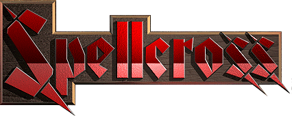

<p align="center">
  
</p>

[English](README.md) | **Čeština**

# Spellcross Reloaded

**Neoficiální open-source obnova hry *Spellcross: Poslední bitva* (1997) pro moderní Windows.**

Spellcross Reloaded přináší původní tahovou strategii jako nativní aplikaci pro Windows. Velte Alianci Země v boji proti Druhé straně (Other Side), spravujte své jednotky na strategické mapě a veďte je do taktických bitev. Projekt využívá původní data kampaně, grafiku a zvuky namísto toho, aby původní hru nahrazoval novou.

**[Vydané verze](https://github.com/luboshorak/spellcross-reloaded/releases)** · **[Nahlásit chybu](https://github.com/luboshorak/spellcross-reloaded/issues)** · **[Editor map](https://github.com/luboshorak/spellcross-reloaded-editor)**

## Stažení a spuštění hry

1. Stáhněte si balíček pro Windows **x64** ze sekce [vydaných verzí](https://github.com/luboshorak/spellcross-reloaded/releases). Balíček ZIP je přenosný (nevyžaduje instalaci); některé verze nabízejí také instalační soubor EXE.
2. Rozbalte celý ZIP do složky, do které máte právo zapisovat, nebo použijte instalační program, pokud je k dispozici.
3. Spusťte `Spellcross.exe`. Při prvním spuštění podle pokynů vyberte umístění **dat původní hry Spellcross** (například z CD, připojeného obrazu ISO nebo existující instalace).

**Data původní komerční hry nejsou součástí balíčku.** Podporovány jsou české a anglické edice. Kompatibilita s daty polské a italské verze je zatím experimentální a nelze ji považovat za plně podporovanou.

Chcete-li později vybrat jiný zdroj herních dat, ukončete hru a spusťte:

```text
Spellcross.exe --select-game-data
```

Pokud Windows hlásí chybějící knihovny Microsoft Visual C++, nainstalujte [Microsoft Visual C++ Redistributable (x64)](https://aka.ms/vc14/vc_redist.x64.exe).

## Herní principy

Spellcross kombinuje dvě roviny tahové strategie:

- **Strategická kampaň:** dobývejte a braňte území, nakupujte jednotky a doplňujte jejich ztráty, vyvíjejte nové technologie, pořizujte vylepšení a organizujte velitele a bojové formace.
- **Taktické bitvy:** rozmísťujte roty, využívejte terén a dohled ve svůj prospěch a řiďte pohyb, útoky, morálku a bojové zkušenosti jednotek.

Reloaded také přidává moderní škálování zobrazení, podporu režimu celé obrazovky a nápovědu přímo ve hře, přičemž zachovává původní vizuální a zvukovou podobu hry.

Jedná se o **aktivně vyvíjený fanouškovský projekt obnovy hry**, nikoli o dokončený komerční remaster. Některé herní mechaniky a okrajové situace se mohou od hry z roku 1997 lišit a stále se mohou objevit chyby nebo regrese.

## Ovládání a uložené hry

Aktuální přehled klávesových zkratek a ovládání myší najdete ve hře v nabídce **Nápověda → Ovládání**. Klávesová zkratka **Alt+Enter** přepíná režim celé obrazovky. Taktickou mapu lze posouvat tažením pravým tlačítkem myši; výběr skupin jednotek lze zapnout nebo vypnout v nastavení.

Pro návrat k uloženému postupu použijte volbu **Pokračovat**. Před opuštěním taktické bitvy nechte probíhající akce a tahy nepřítele dokončit a **před aktualizací na jinou verzi si zazálohujte uložené hry**.

## Editor map

Distribuční balíčky obsahují samostatný editor v umístění:

```text
Editor/spellcross_map_editor.exe
```

Editor umožňuje pracovat s taktickými mapami, jednotkami, terénem, objekty a daty misí. V Reloaded lze pomocí **Ctrl+Alt+O** otevřít vlastní taktickou mapu.

Editor je spravován ve [vlastním repozitáři](https://github.com/luboshorak/spellcross-reloaded-editor).

## Chyby, vývoj a sestavení

Narazili jste na problém? [Založte hlášení](https://github.com/luboshorak/spellcross-reloaded/issues) a uveďte verzi hry, popis situace a postup, jak chybu zopakovat. Při pádu hry mohou pomoci soubory `debug.log` a `crash-last.txt`; viz [návod k hlášení pádů](./docs/runtime-crash-diagnostics.md). Před sdílením diagnostických souborů zkontrolujte, zda neobsahují soukromé údaje.

Pro práci se zdrojovým kódem a technickou dokumentací začněte [příručkou pro vývojáře](./docs/README.md). Požadavky na sestavení pro Windows, tvorbu balíčků a vydávání verzí najdete v [návodu k sestavení](./packaging/README.md). Změny jednotlivých verzí patří do [poznámek k vydání](./packaging/releases/), nikoli na tuto stránku.

## Poděkování a právní informace

Spellcross Reloaded je nezávislý fanouškovský projekt, **nikoli oficiální vydání společnosti Cauldron**.

Projekt navazuje na práci **Stanislava Mašláně**, autora původního open-source [editoru map pro Spellcross](https://github.com/smaslan/spellcross-map-edit), a na práci přispěvatelů k této obnově.

Zakladatel projektu a správce obnovy: **Luboš Horák**. Kód ve vlastnictví projektu, na který se vztahuje pojem Covered Code, je licencován pod [Common Public Attribution License 1.0](./LICENSE), která vyžaduje viditelné uvedení autorství v odvozených aplikacích. Převzatý kód pod licencí MIT a komponenty třetích stran si ponechávají své licence; dříve udělená oprávnění podle licence MIT zůstávají v platnosti. Viz [rozsah licencování](./LICENSING.md), [autoři](./AUTHORS.md) a [licenční informace třetích stran](./THIRD_PARTY_NOTICES.md). **Tyto licence se nevztahují na původní herní data, grafiku, hudbu, zvuky, videa ani ochranné známky hry Spellcross**, které zůstávají majetkem příslušných držitelů práv.
