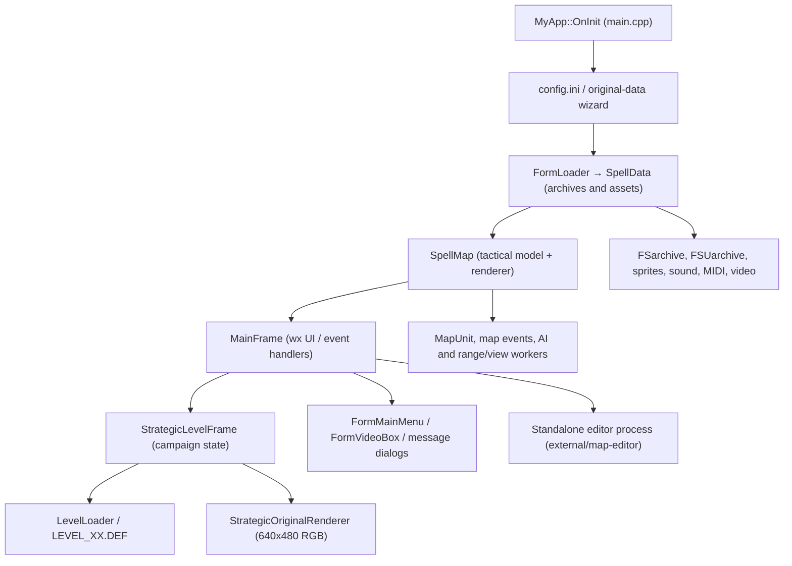

# Architecture

## Application-level ownership

The application is a **wxWidgets event-driven Windows C++17 program**, not an OpenGL game loop. The principal entry is `wxIMPLEMENT_APP(MyApp)` and `MyApp::OnInit` in [`spellcross-map-edit-main/source/main.cpp`](../spellcross-map-edit-main/source/main.cpp). `MyApp` loads configuration, resolves original game data, starts `FormLoader` and creates `SpellMap` and `MainFrame`. `SpellData` owns archive-backed assets and decoded resources. `MainFrame` handles tactical interaction, global transitions and ownership of the active strategic frame; `StrategicLevelFrame` owns campaign models and strategic UI.

`MainFrame::OnTimer` advances tactical state through `SpellMap::Tick` **only while the tactical frame is visible**; `StrategicLevelFrame::OnEndTurn` commits campaign-wide strategic turns. These are distinct time domains.



## Modules and exact source responsibilities

| Source (under `spellcross-map-edit-main/source/`) | Responsibility / important interfaces |
| --- | --- |
| `main.cpp`, `main.h` | `MyApp::OnInit/OnExit`, `MainFrame`, user events (`OnTimer`, `OnCanvas*`), mission deployment, cutscene/strategic navigation, Continue. |
| `spellcross.cpp`, `spellcross.h` | `SpellData::SpellData` imports and composes resources, `SpellDEF` parses tactical commands, edition-dependent text. |
| `map.cpp`, `map.h` | `SpellMap::Load`, `Render`, `Tick`, `EnemyTurnStep`, `CheckReactionFire`, `SaveGameStateToFile`, terrain/unit/event ownership, background range/view workers. |
| `spell_units.cpp`, `spell_units.h` | `SpellUnits::SpellUnits` parses type definitions; `MapUnit::DamageTarget`, `Heal`, `AddExperience`, `Render` and combat/animation state. |
| `spell_map_event.cpp`, `spell_map_event.h` | `SpellMapEvents::AddMissionObjective`, `AddSpecialEvent`, `CheckEvent` and mission-trigger serialization. |
| `level.cpp`, `level.h` | `LevelLoader::LoadLevelDef`, `LevelData`, `LevelMission`, `LevelEvent`; strategic DEF parsing, not tactical drawing. |
| `forms/form_level.cpp`, `forms/form_level.h` | `StrategicLevelFrame` campaign economy, research, unit management, hierarchy, event flow, counterattacks, original and wx UI, JSON saves. |
| `strategic_original_renderer.cpp`, `strategic_original_renderer.h` | Stateless-ish 640×480 original-screen static composition; assets/state in, RGB pixels out. Live labels and click mapping remain in `form_level.cpp`. |
| `sprites.cpp`, `sprites.h` | `Sprite::Decode/Render`, `Terrain::Load`, tile contexts, scenery objects and animation decoding. |
| `spell_graphics.cpp`, `spell_graphics.h` | `SpellGraphics::AddICO/AddCUR/AddPNM`, generic indexed glyphs and projectiles. |
| `fs_archive.cpp`, `fsu_archive.cpp`, `LZ_spell.cpp` | Archive reading, unit-sprite resources, LZ decompression. |
| `spell_sound.cpp`, `spell_midi.cpp`, `spell_video.cpp`, `forms/form_video_box.cpp` | Audio pooling, MIDI, legacy cinematics, MP4 fallback playback and scoped muting. |
| `spell_font.cpp`, `spell_texts.cpp`, `spell_ui_locale.h` | Retail font/text, text wrap and independent authored UI translations. |
| `display_settings.h`, `tactical_zoom.h`, `strategic_ui_theme.h`, `game_menu_bar.h` | Pixel scale, zoom/picking, wx theme and shared menu. |
| `runtime_diagnostics.h`, `startup_log.h` | Session log and startup instrumentation; see [debugging](debugging.md). |

## Strategic-to-tactical round trip

Source of campaign state: `StrategicLevelFrame`. Source of a live battle: `SpellMap`. Data transfer deliberately preserves *persistent* company identities and hierarchy attributes via `LevelData::PlayerUnitAdd`; the battle's transient local identifiers are not strategic identities. Key implementation hooks:

1. `StrategicLevelFrame::ResolveMissionTokenForTerritory` and `OnLaunch` select a mission.
2. `MainFrame::LoadMapFromDefPath` loads scripted `.DEF`, or `LoadGeneratedStrategicBattleFromDtaPath` builds a defensive/recapture mission from original `.DTA`.
3. `MainFrame::PlaceDeploymentUnit` / `FinishDeployment` place selected companies onto START squares.
4. `SpellMap::Tick`, `SpellMap::CheckAndTriggerMissionEnd` request a terminal result.
5. `MainFrame::OnTimer` consumes the result and snapshots earned companies before debrief/videos.
6. `StrategicLevelFrame::HandleMissionResult`, `CollectAndApplyBattleResults`, `ConquestTerritory` persist the campaign outcome; `MainFrame::OpenStrategicAndLoadNext` handles next chapter transitions.

```mermaid
sequenceDiagram
    participant S as StrategicLevelFrame
    participant M as MainFrame
    participant T as SpellMap
    participant L as LevelLoader
    S->>L: Parse LEVEL_XX.DEF
    S->>M: OnLaunch → selected companies + mission
    M->>T: Load DEF or generate battle from DTA
    M->>T: Place companies / FinishDeployment
    loop Visible tactical ticks
        M->>T: Tick()
        T->>T: AI, movement, events, reactions, objective checks
    end
    T-->>M: ConsumeMissionEndRequest()
    M->>M: Freeze mission + snapshot earned companies
    M->>S: HandleMissionResult()
    S->>S: Update territory/roster/stats; save JSON
    M->>M: Debrief → cutscenes → strategy
```

## Runtime boundaries and coupling

The native game and pinned editor are **separate processes and build projects**, even though the game source directory and MSVC project still carry the old editor name. `packaging/Build-CombinedRelease.ps1` builds both. The main game can launch the editor (`MainFrame::LaunchStandaloneMapEditor`), but the editor's implementation is a submodule and should be examined at its pinned revision for internal editor changes.

Historical classes and compatibility helpers remain in place because save formats and original resources cross UI/model boundaries. Do not split `form_level.cpp` or `map.cpp` mechanically: first isolate tested interfaces, then update MSVC project, release paths and regression tests. See [repository layout audit](repository-layout.md).
