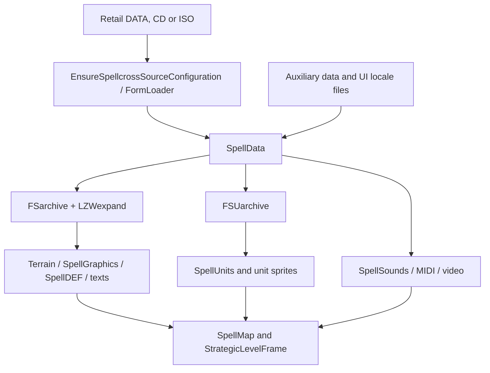

# Data structures, original formats and persistence

## Archive and game data pipeline

The native source is under `spellcross-map-edit-main/source/`. `MyApp::OnInit` (`main.cpp`) resolves an original legally owned CZ/EN installation. `FormLoader` and `SpellData::SpellData` (`spellcross.cpp`) load the archives; the repository does **not** contain the complete original commercial game. The auxiliary `data/` folder and `locales/` are different from the player's retail assets.

| Format / source | Actual reader / writer |
| --- | --- |
| `COMMON.FS`, `T11.FS`, `PUST.FS`, `DEVAST.FS` | `FSarchive::Append/GetFile/DumpToFolder` in `source/fs_archive.cpp`. The header includes count and file-name/offset/length records. |
| `*.LZ`, `*.LZ0` | `LZWexpand::Decode` in `source/LZ_spell.cpp`, called through `FSarchive` for selected options. |
| `UNITS.FSU` and `units.fsa` | `FSUarchive::FSUarchive/LoadResource/LoadAuxData` in `source/fsu_archive.cpp`, instantiated by `SpellData`. |
| `JEDNOTKY.DEF` | `SpellUnits::SpellUnits` and `SpellUnitRec` in `source/spell_units.cpp/.h`; record layout also distinguishes retail CZ/EN editions. |
| Tactical `*.DTA` | `SpellMap::Load/SaveDTA` in `source/map.cpp`; grid, terrain and layers. |
| Tactical `*.DEF` | `SpellDEF` in `source/spellcross.cpp` and `SpellMapEvents::AddMissionObjective/AddSpecialEvent` in `spell_map_event.cpp`; mission directives and triggers. `SpellMap::SaveDEF` is the writer. |
| `LEVEL_XX.DEF` | `LevelLoader::LoadLevelDef` in `source/level.cpp`; `LevelData` / `LevelMission` / `LevelEvent` in `level.h`. Unrecognized commands are recorded in `unknown_lines`. |
| `LEVEL_XX.LZ`, `HMLA__XX.LZ`, `LEVEL_XX.CLK`, `*.PAL` | `StrategicOriginalRenderer::RenderStrategicMap/DecodeClk/BuildPalette` in `strategic_original_renderer.cpp`. |
| `*.ICO`, `*.CUR`, `*.PNM`, `*.BTN`, `*.ANM` | Game-specific indexed graphics, handled by `SpellGraphics`, `Sprite`, `Terrain` and strategic UI asset loaders. Spellcross `.ICO` is not necessarily a Windows icon. |
| `*.CAN` / `*.SMK`, fallback `*.mp4` | `SpellVideo`, `FormVideoBox`; MP4 fallback files must match `data/movie_fallback/MANIFEST.tsv`. |
| Retail names/briefings in `TEXTS.FS` and `COMMON.FS` | `SpellTexts` / `SpellData`, using actual edition language; see `packaging/original-language-resources.md`. |
| `locales/en.lang` / `cs.lang` | UTF-8 key=value authored UI strings through `spellcross_ui_locale::Tr`; see `spellcross-map-edit-main/locales/README.md`. |
| `config.ini` | SimpleIni in `source/SimpleIni.h` and `MyApp::OnInit`; default template `source/config.example.ini`. |

## Campaign state and IDs

`StrategicLevelFrame` (`source/forms/form_level.h/.cpp`) owns persistent territory ownership, missions, economy, research, commanders, formations, unit cooldowns and statistics. `LevelData::PlayerUnitAdd` carries a company's `strategic_uid`, temporary flag, experience and formation/commander-host metadata to `SpellMap`. A tactical `MapUnit::id`, a unit type `type_id` and a persistent strategic `uid` are **not interchangeable**.

Campaign saving uses `StrategicLevelFrame::SaveStrategicGameToPath`, `SaveStrategicState` and `SaveStrategicStateFile` in `forms/form_level.cpp`. Player `slot_YY.json` files are in global `save/strategic/`. Internal per-chapter `level_XX/autosave.json` files remain for transfer; `GetStrategicSaveSlotPath` non-destructively migrates old chapter-specific slots. The retail `BIG_MAP.SAV` importer (`LoadOriginalBigMapSaveFromPath`) is a different binary compatibility path.

## Tactical .scsave is not JSON

`SpellMap::SaveGameStateToFile` in `map.cpp` writes a JSON-like header and then `--PAYLOAD--` followed by versioned binary state. Currently the header declares `"format": "spellcross_map_editor_save"` and `"version": 8`; the binary magic is `0x56435353` (`SSCV`) and payload version is 8. `SpellMap::LoadGameStateFromFile` reads both parts and can resolve legacy absolute map paths by basename.

`MainFrame::SaveTacticalGameWithCampaignContext` appends a campaign snapshot (level definition, current territory/mission, strategic JSON, loss accounting and company UIDs). `LoadTacticalGameWithCampaignContext` restores it, preventing a resumed battle from binding to the wrong campaign. `MainFrame::SaveContinueGame` writes a temporary file then atomically replaces the Continue snapshot using `MoveFileExW`; `LoadContinueGame` chooses strategic versus tactical load from the header.

## Cache and compatibility

`SpellData::SpellData` exports decoded `COMMON.FS` and terrain resources under a runtime `temp/` cache through `FSarchive::DumpToFolder(..., true, true, true)`. Derived caches are disposable, not canonical source files. Do not share retail archives in a public source/release. Preserve optional JSON fields, legacy migration logic, campaign context and tactical binary version when extending persistence; test both old and new saves. The current health/status format and optional `cooldown_reason` are described in [restoration-health-status-terrain.md](restoration-health-status-terrain.md).

See [verification.md](verification.md) for save combinations not independently tested in this documentation pass.
