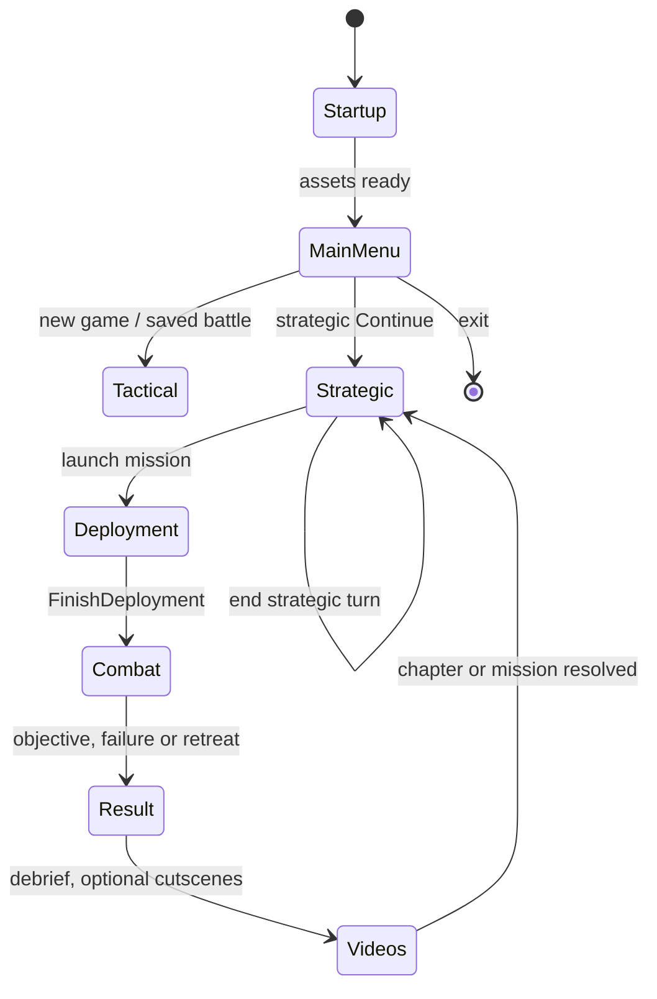

# Lifecycle, state and input

## Startup and shutdown

`wxIMPLEMENT_APP(MyApp)` and `MyApp::OnInit` in [`source/main.cpp`](../spellcross-map-edit-main/source/main.cpp) are the native entry point. Initialization selects a stable runtime directory, starts diagnostics, reads `config.ini` or seeds from `config.example.ini`, restores display settings, runs the original-data source wizard (`EnsureSpellcrossSourceConfiguration`), loads assets using `FormLoader`/`SpellData`, then creates `SpellMap` and `MainFrame`. Shutdown is coordinated by `MainFrame::RequestApplicationExit` and `MyApp::OnExit`; the strategic window and main-menu window are separate top-level wx windows.

`MainFrame::OnMainMenuAction`, `LoadMapFromDefPath`, `LoadGeneratedStrategicBattleFromDtaPath`, `FinishDeployment`, `StartMissionEndFlow`, `PlayNextStrategicCutscene` and `OpenStrategicAndLoadNext` implement the branches. Not every mission includes deployment or movies.

## Tactical timer and drawing

`MainFrame::OnTimer` in `main.cpp` is the periodic tactical update handler (source comments state a 10 ms timer). It calls `SpellMap::Tick` only while the tactical frame is loaded **and shown**. Deployment, message dialogs, a latched mission end and visible result presentations stop simulation. `Tick` in [`source/map.cpp`](../spellcross-map-edit-main/source/map.cpp) advances movement/animation, AI turns, events and reaction fire; it requests a repaint rather than directly drawing the battlefield. Actual drawing is `MainFrame::OnPaintCanvas` -> `SpellMap::Render` -> wx bitmap. The tactical game is therefore event-driven rather than an independent infinite rendering thread.

Input handlers `MainFrame::OnCanvasLMouseDown`, `OnCanvasRMouse`, `OnCanvasMouseMove`, `OnCanvasKeyDown/Up` and `OnCanvasMouseWheel` convert input with `TacticalMousePoint`. Wheel zoom uses `spellcross_tactical::Zoom::Wheel` and `AnchoredScroll`; HUD buttons route through `MainFrame::OnHUDbuttonsClick` and `SpellMap::OnHUD*`.

`SpellMap::StartEnemyTurn`, `EnemyTurnStep`, `EndEnemyTurn`, `CheckReactionFire`, `ProcessReactionFire` and `CheckAndTriggerMissionEnd` are important state boundaries. The end request is polled through `SpellMap::ConsumeMissionEndRequest` in MainFrame's timer; mission-earned companies are snapshotted before result UI and cutscenes, preventing subsequent background AI from changing the result. `RecordMissionLoss` tracks casualties separately from commander notification presentation.

## Strategic turns

`StrategicLevelFrame::OnEndTurn` in `source/forms/form_level.cpp` is an **explicit turn commit**, independent of the tactical timer. Source order is:

1. Validate current research allocation and unresolved enemy attacks.
2. Adjust inaccessible territory deadlines, then increment `m_turn`.
3. Run `CheckTimeouts`, `ProcessLevelEvents`, `CheckTimeouts` again and `CheckCounterAttacks`.
4. Update stats; apply `ApplyResourceTickEndTurn` and `ApplyResearchTickEndTurn`.
5. Reconcile future research allocation and `ApplyUnitsCooldownTick`; generate commander offers.
6. `SaveStrategicState` and `RefreshUI`.

Important distinctions: mission timeout is not automatically territory loss; surrendering an enemy attack creates an occupation/recapture state rather than replaying a completed story objective. See `StrategicLevelFrame::ResolveMissionTokenForTerritory` and `SurrenderCounterAttack`; regression: `tests/test_recapture_mission_lifecycle.cpp`.

## Worker and audio lifecycle

`SpellMap::MoveRange` and `ViewRange` run calculations in `std::thread` workers with atomic state and mutex-protected control. `SpellMap::HaltUnitRanging`, `ResumeUnitRanging`, `LockMap` and `ReleaseMap` coordinate access. `SpellMap::Render` locks results for frame composition. `tests/test_worker_thread_safety.py` asserts synchronization invariants.

`SoundChannels::BackgroundMute` (`source/spell_sound.h`) is a scoped atomic reference-counted suppression of mission audio while `FormVideoBox` plays video. Its nesting and volume semantics are tested by `tests/test_video_background_audio.cpp`. MainFrame queues videos and must not display strategy-only event messages while the tactical frame is still active.

See [architecture](architecture.md), [data formats](data-formats.md), [debugging](debugging.md) and the [verification list](verification.md).
