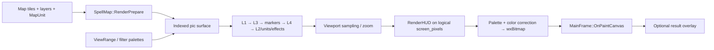

# Rendering and graphics composition

## Tactical: actual frame path

`MainFrame::OnPaintCanvas` ([`source/main.cpp`](../spellcross-map-edit-main/source/main.cpp)) owns the wx paint event and calls `SpellMap::Render(m_buffer, ..., TacticalZoomPercent(), display_scale)`, then draws the resulting bitmap and optional mission-result overlay. `SpellMap::Render` is in [`source/map.cpp`](../spellcross-map-edit-main/source/map.cpp). Tactical graphics are primarily **palette-indexed 8-bit software composition** followed by conversion to a wx RGB bitmap, not GPU layers.

The following is the source-order sequence in `SpellMap::Render` (conditional on visibility flags and mode):

1. Calculate logical surface size for display scale/zoom, `RenderPrepare` camera ranges and allocate/reuse `pic`.
2. Clear visible indexed buffer to `MAP_BACK_COLOR`; lock the map and the unit range/view worker results; copy current tile and animation layers for safe preview substitution.
3. In deployment, only START tiles are revealed. Otherwise use `unit_view->view` to apply unexplored/remembered/visible fog filters, with additional per-tile palette filters.
4. **L1** ground terrain `Sprite::Render`, with staggered offsets and elevation correction.
5. **L3** `AnimL1` frames (`MapLayer3`); then START/ESCAPE/TARGET markers, persistent selection, cursor selection.
6. **L4** `AnimPNM` frames (`MapLayer4`).
7. **L2 scenery + units** in the tile traversal: object sprites (`MapSprite::L2`), `MapUnit::Render`, unit selection pointer, attack/hit effects; projectile position is interpolated between shooter and target.
8. Optional editor overlays (sound markers, event links/labels, other debug/UI markers).
9. Copy/sample the battlefield into `screen_pixels`; invoke `RenderHUD` over the **logical** output.
10. Map palette indices to RGB using display correction and write `wxNativePixelData` of the output `wxBitmap`. `MainFrame` then draws any result overlay.

**Layer nomenclature is historical.** L2/units are deliberately interleaved/depth-ordered by tile traversal, not simply painted as a complete full-screen L2 texture. The exact conditions and overlays are implemented in `SpellMap::Render`, not in generic draw-order assumptions.

## Resources, ownership and caching

- `Sprite::Decode`, `Sprite::Render`, `Terrain::Load` and `Terrain::GetFlatRotatedSprite` (`source/sprites.cpp`) decode palette sprites, terrain atlases/context and optional synthesized rotations.
- `SpellGraphics::AddRaw/AddICO/AddCUR/AddPNM` and `SpellGraphicItem::Render` (`source/spell_graphics.cpp`) cover icon, cursor, PNM and generic 8-bit graphic resources. Note: Spellcross sparse `*.ICO` is **not** necessarily a Windows icon.
- `SpellUnits::SpellUnits`, `SpellUnitRec::Render`, `MapUnit::Render` (`source/spell_units.cpp`) load/render unit-specific sprite and HUD information.
- `FSarchive::Append/LoadFile/FreeFileData` (`source/fs_archive.cpp`) controls optional eager `DELZ_ALL` resource decoding versus lazy `NO_LOAD`; `SpellData::SpellData` initializes archives and exports `COMMON.FS` into a verified `temp/` cache.
- `SpellMap::RenderPrepare` keeps `pic` and `pic_y_buffer` between frames, reallocating when the render surface changes. `MainFrame::OnPaintCanvas` retains `m_buffer` until physical canvas size changes.
- Range/view calculation runs in dedicated workers (`SpellMap::MoveRange`, `ViewRange` in `source/map.cpp`); paint locks results before reading them. Do not mutate/shared access without the established map locks.

`display_settings.h` controls 100/125% output, optional bilinear mode and gamma/brightness/color temperature; `tactical_zoom.h` controls independent gameplay zoom. See [coordinates](coordinates.md).

## Original strategic graphics: two explicit passes

`StrategicOriginalRenderer` ([`source/strategic_original_renderer.cpp`](../spellcross-map-edit-main/source/strategic_original_renderer.cpp)) accepts an `AssetLoader` callback, decoded original resource bytes and view state. Its `RenderStrategicMap`, `RenderHierarchy`, `RenderUnits`, `RenderBuy`, `RenderResearch`, `RenderInfo`, `RenderResources`, `RenderStats` and `RenderOptions` compose a **640×480 RGB image** from native `VM*_FULL`, `LEVEL`, `HMLA`, `SB_BG*`, `SB_BAR*` and other retail assets.

`StrategicLevelFrame::RefreshOriginalStrategicView` (`source/forms/form_level.cpp`) supplies current territory visibility and asset loading (prefer live `COMMON.FS`, then extracted directories), calls the static renderer, and overlays live texts, company states, amounts, buttons and toolbar graphics. `OnOriginalStrategicPaint` scales/centers the cached bitmap; `OnOriginalStrategicLeftDown/RightDown/MouseWheel` remap mouse input into native 640×480 coordinates.

The palette is **banked**: `BuildPalette` uses `_SHARED1.PAL` indexes 0–127, `LEVEL_XX.PAL` indexes 128–191 and `BIG_MAP.PAL` indexes 192–255. `BuildStrategyPalette` replaces the middle band with indexes 128–191 of `STRATEGY.PAL`. Do not apply one 256-color palette wholesale; that corrupts original chrome colors.

Source-verified example: `StrategicOriginalRenderer::BlitListChrome` composes `SB_BG*` at `(412,5)` and `SB_BAR*` at `(556,33)`. The static renderer deliberately does **not** own game logic or wx controls. The view caches `m_originalStrategicBitmap` and uses `m_originalStrategicDirty` to trigger rebuilds; `MarkOverlayDirty` and `OnOriginalStrategicAnimTimer` invalidate when needed.

## Performance and restoration constraints

- Prefer retained decoded original pixels and palette mappings over handmade replacements: see [health/status restoration](restoration-health-status-terrain.md).
- `SpellMap::Render` currently copies whole tile/animation vectors per paint for editor previews (`map.cpp`; source comment notes the inefficiency); changing this requires range-worker and preview safety tests.
- Avoid an additional frame-local decompression/cache layer until measured: `FSarchive` already manages loaded bytes and `SpellData` has a disk cache.
- Several draw elements depend on source edition (CZ/EN). Text/layout must be tested with both retail sets.
- Any performance shortcut involving invisible enemies must preserve **each movement step's AP, triggers, collisions and reaction fire**. The historical plan in `spellcross-map-edit-main/doc/HIDDEN_ENEMY_SIMULATION_REGRESSION.md` documents the necessary scenarios, but its branch-status header is not a current build assertion.

For uncertain pixel parity and full-screen behavior, see [verification](verification.md).
